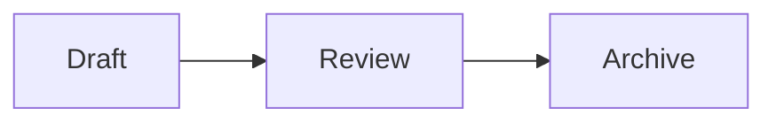

# Markdown, Links, and Diagrams

## Supported Markdown

Nuvyn renders Markdown with `markdown-it` and supports the core syntax plus:

- task lists;
- heading anchors;
- footnotes;
- definition lists;
- `==marked text==`;
- tables and syntax-highlighted code fences;
- automatic links;
- Wiki links;
- GitHub-style Alerts;
- KaTeX inline and block math;
- Mermaid and Markmap fences.
- live Board embeds.

## Callouts

Nuvyn supports five GitHub-style Alerts. A canonical marker at the start of a
blockquote turns that blockquote into a lightweight, typed Alert while the
content inside continues to use normal Markdown.

```md
> [!NOTE]
> This is a note.
```

The supported markers are exactly `NOTE`, `TIP`, `IMPORTANT`, `WARNING`, and
`CAUTION`. Markers are case-sensitive and must occupy the first line of the
blockquote by themselves. Alert titles remain English regardless of the UI language:

| Marker | Display title |
| --- | --- |
| `NOTE` | Note |
| `TIP` | Tip |
| `IMPORTANT` | Important |
| `WARNING` | Warning |
| `CAUTION` | Caution |

For example:

```md
> [!WARNING]
> Back up your data first.
```

Custom titles are not supported, and folded Alerts (`+` / `-` markers) are not
enabled. Legacy, unknown, lowercase, titled, and folded forms remain ordinary
blockquotes; Nuvyn does not silently convert them to canonical Alerts.

## Inline table of contents

Nuvyn does not provide an inline `[[toc]]` Markdown extension. The document's
right-side heading navigation remains available, but no table of contents is
inserted into the Markdown body.

`[[toc]]`, `[[TOC]]`, and `[[Toc]]` all use the normal WikiLink resolver, just
like any other WikiLink. Existing notes that relied on the removed inline
extension should be reviewed manually. See the
[post-MD-EXT compatibility note](../migrations/markdown-post-md-ext-compatibility.md)
for the migration contract.

## Mathematics

Nuvyn renders math with KaTeX. Use single dollar delimiters for an inline
formula:

```md
Euler's identity is $e^{i\pi}+1=0$.
```

Use a `$$` block for a display formula:

```md
$$
\int_0^1 x^2\,dx = \frac{1}{3}
$$
```

Inline formulas stay on one line. Dollars in code spans/fences and escaped
dollars such as `\$100` remain literal text. KaTeX supports a high-performance
subset of LaTeX math syntax; this build does not provide MathJax, equation
numbering, or user-defined global macros.

## Links Between Notes

Use Wiki links or relative Markdown links:

```md
[[inbox/example]]
[[inbox/example|Readable label]]
[[inbox/example#heading]]
[Readable label](../inbox/example.md)
```

Known targets navigate inside the vault. Missing Wiki targets are styled as missing. Links inside inline or fenced code are not indexed.

When renaming a file or folder, Nuvyn can update incoming Wiki and Markdown references. The Links panel shows both outgoing links and backlinks for the current note.

## Diagrams

### Arrange Markdown with Flex

Use the single `flex` container for image rows and other block layouts. Each
direct Markdown block automatically becomes one Flex item, so two images only
need blank-line separation:

```md
::: flex


:::
```

This also works for paragraphs, headings, lists, code blocks, tables, callouts,
Mermaid, and other supported Markdown blocks. A soft line break stays in its
paragraph; use a blank line when two blocks should be separate Flex items.
Images remain normal Markdown resources and keep their existing authentication,
Include, and Attachment Manager reference behavior.

To group several blocks into one item, nest another `flex` container. The
nested container's `grow`, `shrink`, `basis`, `self`, and `order` options size
it as an item in its parent, while its other options arrange its own children:

```md
:::: flex direction=row gap=16

::: flex direction=column grow=1 basis=50%


:::

::: flex direction=column grow=1 basis=50%

### System architecture

The design contains a frontend, backend, and database.

- Vue 3
- Hono
- SQLite

:::

::::
```

Container options and defaults:

| Option | Allowed values | Default |
| --- | --- | --- |
| `direction` | `row`, `row-reverse`, `column`, `column-reverse` | `row` |
| `wrap` | `nowrap`, `wrap`, `wrap-reverse` | `wrap` |
| `justify` | `normal`, `start`, `end`, `flex-start`, `flex-end`, `center`, `left`, `right`, `stretch`, `space-between`, `space-around`, `space-evenly`, and safe/unsafe position variants | `flex-start` |
| `items` | `normal`, `stretch`, baseline variants, start/end/self-start/self-end, flex-start/flex-end/center, and safe/unsafe position variants | `stretch` |
| `content` | `normal`, `stretch`, baseline variants, start/end/flex-start/flex-end/center, space-between/around/evenly, and safe/unsafe position variants | `stretch` |
| `gap` | `0`, `4`, `8`, `12`, `16`, `24`, `32` pixels | `16` |
| `mobile` | `stack`, `preserve` | `stack` |
| `grow` | integer `0`–`4` | `0` |
| `shrink` | integer `0`–`4` | `1` |
| `basis` | `auto`, `0`, `25%`, `33.33%`, `50%`, `66.67%`, `75%`, `100%` | `auto` |
| `self` | `auto`, `stretch`, start/end/self-start/self-end, flex-start/flex-end/center, `baseline`, and safe/unsafe position variants | `auto` |
| `order` | integer `-3`–`3` | `0` |

Multi-word CSS alignment values use hyphens in the Markdown parameter, such as
`items=first-baseline` or `justify=safe-center`. `content=start` uses the
standard CSS `start` value. Arbitrary CSS, inline styles, expressions, URLs,
`calc()`, and `var()` are not accepted.

On narrow Note reading areas, horizontal layouts stack by default. Set
`mobile=preserve` to retain the authored direction; overflow remains contained
within the layout. This breakpoint follows the available article width rather
than the device viewport. Nested Flex is supported at multiple levels; use
longer colon fences for nested containers when it improves readability.

Reverse directions and `order` change visual placement, not DOM or screen-reader
reading order. PDF export applies a separate printable layout. Flex markup is
rendered in Reader, Print/PDF, and other Markdown preview surfaces; edit its
source directly in Monaco. Invalid or incomplete syntax remains ordinary
Markdown.

The former `image-row` syntax was removed after confirming it does not occur in
the repository's default `src/content` vault Markdown. Existing image
references there now use the same `flex` container as every other layout. See the
[Flex Container design note](../design/note-flex-container-prd.md) for parser,
security, responsive, PDF, and reference-index details.

### Embed a Board

Draw a diagram in **Board**, then choose **Copy Note reference** in the Board
editor's menu. Paste the copied Markdown on its own line in a Note:

```md

```

Reading and preview modes display a crisp SVG image of the saved Board. Click
the image to return to the Board editor. The reference uses a
stable Board ID, so renaming the Board does not break it; the image's alternative
text uses its current title. Saving a Board updates the embed when you return to the
Note. Visible Notes also check for changes every 15 seconds while the browser
tab is active. Only the saved server version is shown, not recovery drafts.

Deleted Boards show a clear missing-reference message. Network/rendering
failures offer **Reload**. Embeds use the existing authenticated Board/Asset
APIs and do not change the Board's last-opened time. They require Nuvyn to
render; use PNG/SVG export when sharing a static diagram outside Nuvyn.

### Mermaid and Markmap

Use a `mermaid` fence for diagrams and a `markmap` fence for an interactive outline map:

````md


```markmap
# Topic
## Branch
- Detail
```
````

Mermaid runs with `securityLevel: 'strict'`. Both diagram types are mounted only after the sanitized Markdown render completes.

## HTML Safety

Semantic HTML is enabled for compatibility, but the final rendered HTML passes through a DOMPurify allowlist before Vue inserts it. Scripts, event handlers, styles, iframes, embedded objects, SVG, forms, and unsafe URLs are removed. AI chat Markdown is stricter and disables raw HTML entirely.

For the full boundary, see [Deployment Security](../deployment/security.md).
