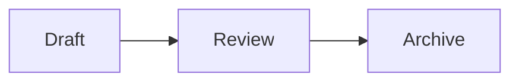

# Markdown, Links, and Diagrams

## Supported Markdown

Nuvyn renders Markdown with `markdown-it` and supports the core syntax plus:

- task lists;
- heading anchors;
- footnotes;
- definition lists;
- `==marked text==`;
- tables and syntax-highlighted code fences;
- automatic links;
- Wiki links;
- GitHub-style Alerts;
- KaTeX inline and block math;
- Mermaid and Markmap fences.
- live Board embeds.

Headings, lists, quotes and code fences are ordinary Markdown. Task lists,
tables and footnotes are common extensions, though support varies between
Markdown readers. Flex, Code Group, Snippet/Include, Board references and
`@/` resource paths require Nuvyn's rendering support.

Markdown export preserves the original source, including extension markers;
it does not bundle referenced resources. HTML and PDF export provide static
presentations. They do not preserve every Reader interaction, such as Code
Group tabs, editable diagrams or live Board updates.

## Task lists

Write task states in Monaco's edit mode:

```md
- [ ] Not finished
- [x] Finished
- [X] Also finished
  - [ ] Nested task
```

Reader checkboxes display these states and are disabled. Clicking a checkbox
or its label, tapping it, or pressing Space cannot edit or save the task.
Change `[ ]` to `[x]` (or back) in the Markdown source, then return to Reader
to see the new state. Preview, HTML and PDF also display the source's task
states without offering task editing.

## Structural folding

In edit mode, use Monaco's native gutter chevrons to fold headings (H1–H6)
and fenced code. Other structures rely on Monaco's existing behavior, without
dedicated Nuvyn folding rules. Native Fold All, Unfold All and Fold Level commands are available.
ATX and Setext headings follow the same hierarchy: a section ends at the next
heading of the same or higher level, within its enclosing container.

On desktop, folding chevrons appear when hovering over the corresponding
heading/block (or Monaco gutter). Reader controls also appear on keyboard
focus; touch devices keep controls visible. Revealing controls does not move
the content.

In reading mode, only section headings receive chevrons. A leading H1 is
treated as the document title and has no folding control; later H1 sections
and H2–H6 can fold until the next same/higher heading in their container.
Lists, quotes, code, layouts, Callouts, images, tables, diagrams and Board
previews receive no independent fold controls. Details and Code Group retain
their existing interactions. Fold buttons support Tab, Enter and Space,
including on touch devices.

Nested states are independent: expanding a parent does not unfold its children.
TOC links, internal anchors and Wiki-link anchor navigation reveal the necessary
ancestors before scrolling. The full H2–H4 outline remains available; hidden
headings do not participate in scroll tracking. Editor search/anchor reveals
also unfold the hidden ancestors of the destination.

Folding changes only the view. It does not change text, task values, saves or
history. Reader state is memory-only and resets when its document/surface is
remounted, including a mode switch, rename, close or Diary lock. Editor folding
uses the existing Monaco view-state lifecycle independently of Reader state.
PDF and HTML exports use separate, fully expanded render surfaces; Markdown
export remains the original source.

Boundaries: no extra disclosure is added to native Details or Flex;
Code Group keeps its tabs without independent panel folding. Sections inside
a container stop at that container's boundary. Documents at or above 500,000 characters
retain the large-document protection and do not receive structural folding.

## Callouts

Nuvyn supports five GitHub-style Alerts. A canonical marker at the start of a
blockquote turns that blockquote into a lightweight, typed Alert while the
content inside continues to use normal Markdown.

```md
> [!NOTE]
> This is a note.
```

The supported markers are exactly `NOTE`, `TIP`, `IMPORTANT`, `WARNING`, and
`CAUTION`. Markers are case-sensitive and must occupy the first line of the
blockquote by themselves. Alerts display only their body, without a generated
type title or empty title row. They use the same thin left-border treatment as
ordinary quotes, with a soft type-colored background and border. This applies
to reading mode, light/dark themes, and PDF export. Ordinary quotes use the
same compact font size, line height, and padding as Alerts while retaining
their own colors. Heights remain content-driven; colon-fenced containers
remain borderless pastel cards.

For example:

```md
> [!WARNING]
> Back up your data first.
```

Custom titles are not supported, and folded Alerts (`+` / `-` markers) are not
enabled. Legacy, unknown, lowercase, titled, and folded forms remain ordinary
blockquotes; Nuvyn does not silently convert them to canonical Alerts.

## Custom containers

Use `info`, `tip`, `warning`, `danger`, or `details` with a colon fence.
Containers show a title only when you explicitly supply an alias after the
type. Without an alias, only the body is displayed, with no default type
label or empty title row:

```md
::: info
This container has no title.
:::

::: warning Back up first
This container displays the title "Back up first".
:::
```

Aliases support safe inline Markdown, such as `::: tip **Useful** advice`.
A `details` container needs an alias for its clickable disclosure title:
`::: details Read more` starts closed, while `::: details Read more {open}`
starts open. Without an alias, `details` displays its body directly as a
non-collapsible card, including when only `{open}` is supplied. PDF export
retains explicit aliases and expands named details without changing the reader.
Expanded, named `details` show a faint separator below their title in reading
mode and PDF export. The separator disappears when collapsed and is not added
to untitled containers or other container types.

Only these colon-fenced containers support aliases. GitHub-style Alerts above
always display only their body; Flex layout syntax is unchanged.

As a writing convention, use GitHub Alerts for short reminders, cautions and
warnings. Use `info`/`tip`/`warning`/`danger` containers for a more substantial
explanation, knowledge card or process description. Use Details for supporting
material the reader should deliberately expand. These are suggestions, not
additional syntax rules.

## Code fences and metadata

Start with a language identifier after the opening backticks:

````md
```java
System.out.println("Hello");
```
````

Supported languages receive syntax highlighting; unknown languages fall back
to readable plain code. A code block's language label also copies its code
when clicked or keyboard-activated.

Line numbers are off by default. Use `:line-numbers` to start at 1,
`:line-numbers=10` to start at 10, or `:no-line-numbers` to turn them off.
The starting number must be an integer from 1 to 100,000. Modifiers may follow
the language directly or be separated by spaces. A later valid line-number
modifier takes precedence.

Use `{2,4-5}` to highlight lines 2, 4 and 5. These are one-based positions in
the code block, regardless of the displayed starting line number. Lists of
positive line numbers and inclusive ranges are supported, with no spaces
inside the braces. `[example.ts]` supplies a display label for a Code Group
member; on an ordinary standalone fence it does not add a filename header.

````md
```ts:line-numbers=10 {2,4-5} [example.ts]
const first = 1
const second = 2
const third = 3
const fourth = 4
const fifth = 5
```

```ts:no-line-numbers
const answer = 42
```
````

Diff and Focus use source annotations inside a code comment, rather than
fence-info parameters. Use the comment syntax for the language being shown:

````md
```ts
const oldValue = 1 // [!code --]
const newValue = 2 // [!code ++]
```

```ts
const context = "background"
const important = 1 // [!code focus:2]
const alsoImportant = 2
```

```ts
const important = 1 // [!code highlight]
```
````

`[!code ++]` and `[!code --]` mark added/deleted lines. `[!code focus]`
focuses one line; `[!code focus:N]` focuses that line and the following lines,
for a total of `N` (1–1,000). `[!code highlight]` highlights one line.
Recognized notation markers are removed from the displayed code.

For example, `{3-1}`, `{0}` and `:line-numbers=0` are invalid fence metadata;
they do not erase the code or grant arbitrary CSS styling. `[!code highlight:2]`
is not supported and stays literal code text. `focus` and `diff` are not
fence-info switches. Special diagram fences must use exactly `mermaid` or
`markmap`, without labels or other metadata, to mount a diagram.

## Code Group

Use `::: code-group`, followed only by labeled, closed code fences and blank
lines, then a closing `:::`:

````md
::: code-group

```java [Java]
System.out.println("Hello");
```

```python [Python]
print("Hello")
```

:::
````

One or more code blocks are accepted; every member needs a nonempty `[Label]`.
Labels may contain spaces and Unicode text. Members accept the same valid
language, line-number and line-highlight metadata described above, as well as
the supported source annotations. Ordinary paragraphs and unlabeled code
blocks cannot be members. The opening delimiter can have more than three
colons; its closing delimiter must have at least as many, with no title or
other parameters on either delimiter.

Reader initially shows the first member. Click a tab or use the arrow keys,
Home and End while a tab has focus to choose another member. Invalid or
unclosed groups fall back to ordinary Markdown, retaining their code rather
than silently dropping it. HTML and PDF export show every member in source
order, each with its label, instead of exporting only the active tab.

## Snippets

A Snippet reads an existing UTF-8 text file and displays selected code. Put
the directive on a line of its own, outside code fences, code spans and HTML
blocks. For a Note at `guides/page.md`, this reads
`guides/examples/hello.ts`:

```md
<<< ./examples/hello.ts
```

Choose source lines with a one-based, inclusive range. Multiple ranges are
joined in the supplied order; `{3,}` means line 3 through the end:

```md
<<< ./examples/hello.ts{2-4}
<<< ./examples/hello.ts{1,3-4}
<<< ./examples/hello.ts{3,}
```

To select a named region, place matching markers in the referenced file:

```ts
// #region greeting
export function greet() {
  return "Hello"
}
// #endregion greeting
```

```md
<<< ./examples/hello.ts#greeting
```

Region marker lines are excluded. Missing, unbalanced or mismatched regions
fail the reference. Use either a region or line ranges for a clear selection;
if both are supplied, region selection takes precedence.

The language is inferred from the file extension. You can explicitly provide
a language and line-number modifier inside braces, followed by an optional
label after a space:

```md
<<< ./examples/hello.ts{2-4 typescript:line-numbers=10} [Greeting]
```

The label becomes code-fence metadata (a tab label when used in a valid Code
Group), not a separate standalone title. Snippet modifiers support language
and `:line-numbers`, `:line-numbers=N`, `:no-line-numbers`; they do not accept
arbitrary fence metadata. For example, `{3-}` is not an open-ended range.

Relative paths resolve from the document containing the directive, including
an included document. `../` may walk up within the Vault; `@/examples/hello.ts`
starts at the Vault root. Paths are Vault resources, not host filesystem paths
or remote URLs. They cannot escape the Vault or use hidden path segments,
spaces, query strings, backslashes or non-ASCII filenames. Each path segment
starts with an ASCII letter/digit and otherwise uses letters, digits, `.`,
`_` or `-`. Existing access controls also apply.

Supported Snippet file extensions are:

```text
.ts .tsx .js .jsx .mjs .cjs .vue .css .scss .less .html .xml .json
.yaml .yml .toml .sql .py .java .go .rs .rb .php .sh .bash .zsh .fish
.c .h .cc .cpp .hh .hpp .cs .kt .kts .swift .dart .lua .r .txt
```

The selected code is limited to 256 KiB; the server also bounds the source
file read. Missing, inaccessible, binary or invalid UTF-8 files, invalid
ranges and other reference errors display `Unable to load Markdown resource.`
in place of that reference. A Snippet follows the saved resource when the
Note renders again; pasted code is instead a fixed copy in the Note's source.

## Include

Include expands another Markdown file as document content, rather than
showing its source as a code block. Put this comment on its own line:

```md
<!--@include: ./parts/intro.md-->
```

For `guides/page.md`, the target is `guides/parts/intro.md`. An Include inside
that file resolves its own relative references from `guides/parts/intro.md`.
For a Vault-root reference, use:

```md
<!--@include: @/shared/intro.md-->
```

Only `.md` files are accepted. The same Vault path and access restrictions
as Snippets apply. The included file contributes raw Markdown body content;
it is not opened as a separate Note with a separate frontmatter-title pass.
Prefer body-only fragments. Its headings share the containing document's
anchor allocation; H2–H4 appear in the same TOC, and duplicate IDs are
disambiguated. Relative Note links and local images retain the included file
as their source location. They still use Nuvyn's Wiki-link resolution and
authenticated image pipeline; Include does not copy or upload attachments.

At most 8 nested Include levels are allowed. Cycles, missing/inaccessible
files, invalid selections and size-limit failures show the same resource
error placeholder at the failing reference. Each included selection is
limited to 512 KiB, and expanded Markdown is limited to 2 MiB overall.
Include has no language, line-number or label parameters. A directive written
inside a code fence or code span stays literal, as does one inside a larger
HTML block.

## Inline table of contents

Nuvyn does not provide an inline `[[toc]]` Markdown extension. The document's
right-side heading navigation remains available, but no table of contents is
inserted into the Markdown body.

`[[toc]]`, `[[TOC]]`, and `[[Toc]]` all use the normal WikiLink resolver, just
like any other WikiLink. Existing notes that relied on the removed inline
extension should be reviewed manually. See the
[post-MD-EXT compatibility note](../migrations/markdown-post-md-ext-compatibility.md)
for the migration contract.

## Mathematics

Nuvyn renders math with KaTeX. Use single dollar delimiters for an inline
formula:

```md
Euler's identity is $e^{i\pi}+1=0$.
```

Use a `$$` block for a display formula:

```md
$$
\int_0^1 x^2\,dx = \frac{1}{3}
$$
```

Inline formulas stay on one line. Dollars in code spans/fences and escaped
dollars such as `\$100` remain literal text. KaTeX supports a high-performance
subset of LaTeX math syntax; this build does not provide MathJax, equation
numbering, or user-defined global macros.

## Links Between Notes

Use Wiki links or relative Markdown links:

```md
[[inbox/example]]
[[inbox/example|Readable label]]
[[inbox/example#heading]]
[Readable label](../inbox/example.md)
```

Known targets navigate inside the vault. Missing Wiki targets are styled as missing. Links inside inline or fenced code are not indexed.

When renaming a file or folder, Nuvyn can update incoming Wiki and Markdown references. The Links panel shows both outgoing links and backlinks for the current note.

### Explicit heading anchors

Automatic anchors are derived from heading text: text is lowercased, ASCII
letters/digits and Chinese characters are retained, and other runs become
hyphens. Use an explicit ID when a stable link should survive wording changes:

```md
## 数据库事务 {#database-transaction}

[Jump to this section](#database-transaction)
[[inbox/java-guide#database-transaction]]
```

The `{#id}` suffix must be the final text in the heading, separated from the
heading text by whitespace. The ID must start with an ASCII letter and be
1–128 characters long; remaining characters may be ASCII letters/digits, `.`,
`_`, `:`, or `-`. The suffix is removed from the displayed title. Duplicate
IDs are disambiguated (for example, `database-transaction-2`); use unique IDs
when authoring cross-note links.

TOC entries and local/Wiki anchors use the final allocated ID. Invalid forms,
such as `## Title {#123}` or `## Title{#stable}`, stay visible as heading text
and use the automatic anchor. Escaping the opening brace also keeps the
marker literal. Changing an existing explicit ID can break links from other
Notes, so update incoming references when renaming anchors.

## Diagrams

### Arrange Markdown with Flex

Use the single `flex` container for image rows and other block layouts. Each
direct Markdown block automatically becomes one Flex item, so two images only
need blank-line separation:

```md
::: flex


:::
```

This also works for paragraphs, headings, lists, code blocks, tables, callouts,
Mermaid, and other supported Markdown blocks. A soft line break stays in its
paragraph; use a blank line when two blocks should be separate Flex items.
Images remain normal Markdown resources and keep their existing authentication,
Include, and Attachment Manager reference behavior.

To group several blocks into one item, nest another `flex` container. The
nested container's `grow`, `shrink`, `basis`, `self`, and `order` options size
it as an item in its parent, while its other options arrange its own children:

```md
:::: flex direction=row gap=16

::: flex direction=column grow=1 basis=50%


:::

::: flex direction=column grow=1 basis=50%

### System architecture

The design contains a frontend, backend, and database.

- Vue 3
- Hono
- SQLite

:::

::::
```

Container options and defaults:

| Option | Allowed values | Default |
| --- | --- | --- |
| `direction` | `row`, `row-reverse`, `column`, `column-reverse` | `row` |
| `wrap` | `nowrap`, `wrap`, `wrap-reverse` | `wrap` |
| `justify` | `normal`, `start`, `end`, `flex-start`, `flex-end`, `center`, `left`, `right`, `stretch`, `space-between`, `space-around`, `space-evenly`, and safe/unsafe position variants | `flex-start` |
| `items` | `normal`, `stretch`, baseline variants, start/end/self-start/self-end, flex-start/flex-end/center, and safe/unsafe position variants | `stretch` |
| `content` | `normal`, `stretch`, baseline variants, start/end/flex-start/flex-end/center, space-between/around/evenly, and safe/unsafe position variants | `stretch` |
| `gap` | `0`, `4`, `8`, `12`, `16`, `24`, `32` pixels | `16` |
| `mobile` | `stack`, `preserve` | `stack` |
| `grow` | integer `0`–`4` | `0` |
| `shrink` | integer `0`–`4` | `1` |
| `basis` | `auto`, `0`, `25%`, `33.33%`, `50%`, `66.67%`, `75%`, `100%` | `auto` |
| `self` | `auto`, `stretch`, start/end/self-start/self-end, flex-start/flex-end/center, `baseline`, and safe/unsafe position variants | `auto` |
| `order` | integer `-3`–`3` | `0` |

Multi-word CSS alignment values use hyphens in the Markdown parameter, such as
`items=first-baseline` or `justify=safe-center`. `content=start` uses the
standard CSS `start` value. Arbitrary CSS, inline styles, expressions, URLs,
`calc()`, and `var()` are not accepted.

On narrow Note reading areas, horizontal layouts stack by default. Set
`mobile=preserve` to retain the authored direction; overflow remains contained
within the layout. This breakpoint follows the available article width rather
than the device viewport. Nested Flex is supported at multiple levels; use
longer colon fences for nested containers when it improves readability.

Reverse directions and `order` change visual placement, not DOM or screen-reader
reading order. PDF export applies a separate printable layout. Flex markup is
rendered in Reader, Print/PDF, and other Markdown preview surfaces; edit its
source directly in Monaco. Invalid or incomplete syntax remains ordinary
Markdown.

The former `image-row` syntax was removed after confirming it does not occur in
the repository's default `src/content` vault Markdown. Existing image
references there now use the same `flex` container as every other layout. See the
[Flex Container design note](../design/note-flex-container-prd.md) for parser,
security, responsive, PDF, and reference-index details.

### Embed a Board

Draw a diagram in **Board**, then choose **Copy Note reference** in the Board
editor's menu. Paste the copied Markdown on its own line in a Note:

```md

```

Reading and preview modes display a crisp SVG image of the saved Board. Click
the image to return to the Board editor. The reference uses a
stable Board ID, so renaming the Board does not break it; the image's alternative
text uses its current title. Saving a Board updates the embed when you return to the
Note. Visible Notes also check for changes every 15 seconds while the browser
tab is active. Only the saved server version is shown, not recovery drafts.

Deleted Boards show a clear missing-reference message. Network/rendering
failures offer **Reload**. Embeds use the existing authenticated Board/Asset
APIs and do not change the Board's last-opened time. They require Nuvyn to
render; use PNG/SVG export when sharing a static diagram outside Nuvyn.

### Reuse an image from Attachment Manager

Open **Settings → Storage & attachments** to inspect and preview supported
images. The manager's upload action adds an image to the Note image library;
it does not accept arbitrary files. In a Note, choose **Insert image** and then
select a Vault image to insert its existing reference, or a Board image to
import a validated copy into the Note library. In Board, open the editor menu
and choose **Insert image from attachments**: a Board image keeps its Asset
identity, while a Vault image is imported as a new Board Asset. These actions
use the existing Note and Board save/recovery flows. Diary content is excluded.

The manager's cleanup check is advisory only; it does not delete or quarantine
resources. A missing current reference is not proof that a file is safe to
remove.

### Mermaid and Markmap

Use a `mermaid` fence for diagrams and a `markmap` fence for an interactive outline map:

````md


```markmap
# Topic
## Branch
- Detail
```
````

Mermaid runs with `securityLevel: 'strict'`. Both diagram types are mounted only after the sanitized Markdown render completes.

## HTML Safety

Semantic HTML is enabled for compatibility, but the final rendered HTML passes through a DOMPurify allowlist before Vue inserts it. Scripts, event handlers, styles, iframes, embedded objects, SVG, forms, and unsafe URLs are removed. AI chat Markdown is stricter and disables raw HTML entirely.

For the full boundary, see [Deployment Security](../deployment/security.md).
